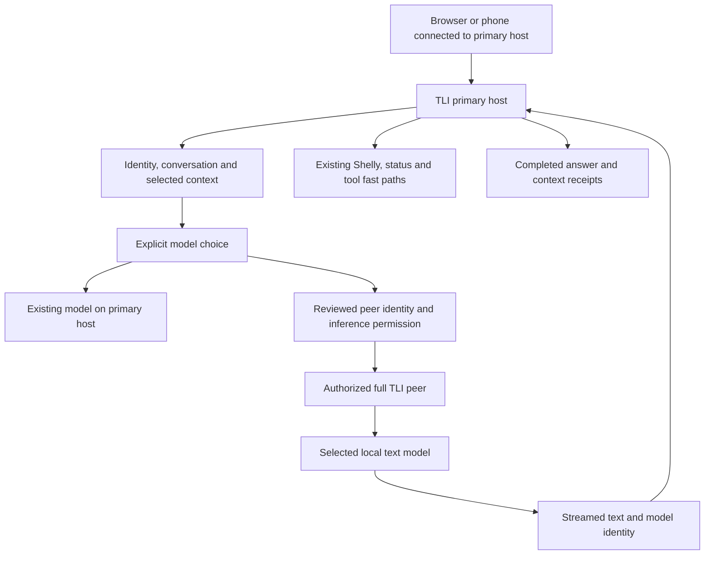

# TLI: LAN-native, offline-capable intelligence

TLI is a private, general-purpose AI that can also work with the user's home,
computers and connected devices. Conversation, learning, writing, brainstorming,
planning and coding belong at its center, with no device task required. It
combines local intelligence, persistent context, explicitly authorized tools
and resources on the local network. Models are replaceable resources within TLI;
they do not define its identity. The product remains **TLI**.

## One direction, several connected capabilities

| Capability | Role in the product |
| --- | --- |
| General AI | Answer questions, explain ideas, draft and revise writing, brainstorm, plan and discuss code in ordinary conversation. Connected tools are optional capabilities. |
| Offline intelligence | Conversation and supported work remain useful without WAN access after models and required dependencies have been installed. |
| Shelly and smart devices | Preserve existing controls, named devices, available measurements and reviewed routines. Supported local device interfaces remain useful without the internet. |
| Computers and shared AI compute | Use a specifically authorized model on another computer while keeping the user's conversation on the primary TLI host. |
| Memory and context | Keep owner-scoped conversations and relevant saved notes coherent across model choices. Honor sharing opt-outs and identify the source of evidence. |
| Tools and task execution | Carry out supported actions through their existing permission and review boundaries, with truthful outcomes. |
| Builder | Create small private HTML/CSS/JS apps with local or explicitly selected LAN inference, retained versions, isolated previews, advisory smoke checks and a repair loop. General coding reliability remains a measured goal. |

Shelly and smart devices are a core part of this direction, not a legacy feature
to remove after shared inference or Builder arrives. Existing Vault, files,
diagnostics, device drivers and interface remain useful capabilities. Their
integration should follow real user workflows rather than a broad rewrite.

## Architecture and reusable foundations

The existing FastAPI host serves the browser UI, authenticates local users and
owns JSON-backed configuration, conversations and saved context. The current AI
route already places deterministic status answers, Shelly/action intents and
read-only tools ahead of general model inference. The new compute path preserves
that ordering.

The existing signed peer identity and trust system supplies persistent node IDs,
reviewed identity cards, pinned HTTPS certificates, specific grants, replay
protection and revocation. Discovery is only a hint; it does not authorize a
computer. Shared inference extends that system with its own permission rather
than inventing a second node registry or trusting an IP address.

The owner-scoped continuity layer prepares the primary host's instructions,
permitted saved notes, complete conversation exchanges and any supported local
evidence before inference. The peer receives that prepared text. It does not
reconstruct the conversation using another user's state or relabel primary-host
observations as measurements of the compute peer.



This first topology has one primary host and one or more explicitly selected
compute peers. The primary host owns the conversation. If it is unavailable, its
interface, history and coordination are unavailable; this change does not provide
replicated memory, automatic failover or independent offline clients.

The implementation boundaries are:

| Module | Responsibility |
| --- | --- |
| `backend/peer_trust.py` | Extend existing reviewed grants and signed transport with inference. |
| `backend/lan_inference.py` | Explicit resource catalog, resource binding, pinned streaming transport and stateless local worker. |
| `backend/routers/lan_inference_routes.py` | Browser resource selection and separately authenticated peer compute endpoints. |
| `backend/ai/lan_chat.py` | Prepare requester-owned context, enforce sharing choices and save completed remote answers. |
| `backend/stream_lifecycle.py` | Close the inference stream and release resources on completion or disconnect. |
| `backend/ai/ai_routes.py` | Add the optional chat choice after existing deterministic actions and expose compute provenance. |
| `frontend/js/lan-inference.js` | Deliberate peer/model checking and choice, with sharing explanation and errors. |
| `backend/tests/test_lan_chat.py` | Synthetic integration acceptance for chat, context, ownership, interruption and preserved local actions. |

## First implementation slice: explicit trusted LAN inference

The first slice connects the existing conversational interface to a reviewed
text model on another full TLI installation. The second slice adds a separate
lightweight Node for a loaded LM Studio model; its local setup and portable
package are described in [the Node guide](../node/README.md).

1. Both computers review each other's identity and HTTPS certificate through the
   existing computer trust workflow, granting inference explicitly.
2. The user opens LAN inference, reads the local list of eligible peers and
   explicitly checks a selected computer's models. Listing peers does not probe
   the LAN. A model check may contact only the chosen trusted peer.
3. The user selects a checked model. Ordinary questions sent with that choice
   include the primary host's permitted prepared context. The UI explains this
   sharing before selection.
4. Existing deterministic local action, status and tool routes still handle
   matching requests. Selecting remote compute does not retarget a Shelly action
   to the peer, grant tool access to a model or run the action twice.
5. Both streaming and non-streaming chat use the same remote inference path.
   They preserve the primary conversation ID and owner, identify the remote
   model/computer and save a completed assistant answer only after completion.
6. An interruption, revoked permission, expired session, changed resource or
   unavailable peer ends the request. No automatic retry, other peer or local
   fallback receives the private context. A later retry is a new deliberate
   request.

### Chat contract

`POST /api/ai/chat` and `POST /api/ai/chat/stream` accept an optional
`lan_inference` object:

```json
{
  "peer_id": "persistent-reviewed-node-id",
  "trust_revision": "sha256-of-reviewed-trust",
  "resource_id": "selected-resource-id",
  "resource_revision": "sha256-of-checked-resource"
}
```

The revision values come from the model-selection API; clients must not invent
them. A peer ID identifies a computer; a friendly name is a display label. The
resource ID identifies a supported inference resource on that computer. Trust
and resource changes require a new check instead of silently selecting another
model or endpoint.

The existing `use_saved_memory` and `use_conversation_history` flags apply before
text leaves the primary host. The selection does not override them. Conversation
ownership is resolved from the authenticated session, never a supplied user ID.
The completed reply uses `provider: "lan"`, `handled_by: "lan_inference"`, the
actual returned `model`, and `inference_host: {id, name}`. Saved evidence `host`
continues to identify the context source; it is separate from `inference_host`.

Explicit images, documents, selected Notebook notes and case selections remain
standalone input contracts. Combining those inputs with this text-only LAN choice
is rejected before another reference/provider route processes them. Users choose
an existing supported local workflow for those inputs. This slice does not imply
remote vision, arbitrary file sharing or automatic model routing.

The EventSource GET fallback has no LAN-selection field. A selected LAN request
must not downgrade to that fallback and silently execute on another destination.

### Inference protocol and supported resources

The additive compute protocol is `tli-peer-inference-v1`.

| Endpoint | Behavior |
| --- | --- |
| `GET /api/ai/lan/peers` | Return eligible reviewed peers from the primary host's directory; no network discovery or model calls. |
| `POST /api/ai/lan/models` with `{peer_id}` | Explicitly inspect one reviewed peer's resources and return trust/resource revisions for selection. |
| `GET /agent/peer/inference` | Peer-authenticated capability request for supported running local resources. |
| `POST /agent/peer/inference/stream` | Peer-authenticated inference worker for bounded prepared text; streams metadata, deltas and completion. |

Both hosts need the new inference grant and protocol support. Existing identity
cards and other capability contracts are retained. The peer's metadata identifies
its protocol, persistent identity, selected resource/revision, provider and model.

The supported resources are an already-running, healthy bundled runtime and
loaded LM Studio models reported by the configured loopback server's
`/api/v1/models` API. This slice does not integrate LM Studio API keys; older
servers or servers requiring a token cannot supply LM Studio resources here.
Non-loopback model server addresses are refused to prevent an apparently local
peer resource from forwarding the context to an unrelated destination. TLI does
not send model load, switch or download calls and does not start the bundled
runtime through this worker.

For a strict **no automatic model start** policy with LM Studio, disable its
server setting **Just in Time Model Loading**. The worker checks that its selected
instance is loaded, including immediately before sending inference, but it cannot
atomically control an external runtime. If the instance unloads between that
check and the inference POST, LM Studio may load it again when its JIT setting is
enabled. There is no per-request switch in this integration that overrides that
server behavior. Treat disabling JIT as a prerequisite for the strict policy.
See LM Studio's [JIT behavior](https://lmstudio.ai/docs/developer/core/ttl-and-auto-evict)
and [server settings](https://lmstudio.ai/docs/developer/core/server/settings).

The initial worker accepts at most 128 KiB of prepared input, limits output to
2,048 requested tokens and 128 KiB of returned answer text, allows one worker
operation at a time, and uses a 120-second deadline. SSE events and total wire
data are also bounded. These limits are deliberate v1 constraints, not model
performance measurements.

### Security boundaries

Peer communication uses the existing reviewed identity, authenticated HTTPS and
certificate pin. Inference is a separately reviewed capability. The compute peer
serves model inference only: it does not invoke the normal chat intent engine,
read the peer owner's conversation or notes, or execute tools supplied by a
remote model. Selected context is disclosed to the chosen peer for inference,
so that peer must be a trusted computer.

The original requester session, peer grant and selected resource remain bound to
the operation. Checks repeat during the operation; changes must stop it without
persisting an apparently completed answer. Unsupported peers, incompatible
contracts, certificate/address changes and redirects fail explicitly. The new
path does not use discovery as authorization or fall back to unsigned HTTP mesh
inference.

This is inference permission, not computer administration permission. No remote
shell, process termination, application launch, screen capture, file indexing or
automatic repair is introduced.

## Staged evolution

| Stage | Complete user experience and acceptance gate |
| --- | --- |
| 1. Trusted shared conversation | From a browser or phone, use one reviewed computer's text model without losing primary-host history or sharing choices. Retain local Shelly actions in the same chat. Pass synthetic regression tests, then complete the two-computer trial below. |
| 2. Lightweight Windows Node | Implemented as a separate compute-only process with local CLI setup, persistent identity, signed pairing, revocation and an allowlisted source bundle. Shares loaded loopback LM Studio models; it has no host UI, administration API, observations or device actions. Physical Windows/LAN acceptance remains required. |
| 3. Practical environmental context | Extend device names, rooms, aliases and dated observations through existing records. Add bounded process/hardware reads only with separate read grants. Preserve unknown and stale readings; disk capacity alone is not storage health. |
| 4. Offline Builder experiment | Implemented for small HTML/CSS/JS apps: brief, saved versions, preview, advisory browser checks, repair and ZIP download. Local or explicitly reviewed LAN compute. Independent acceptance and repeated model trials remain necessary before promising general reliability. |
| 5. Connected tasks | Combine explicitly configured smart-device routines, project context and computer capabilities into repeatable tasks. Add automatic resource choice only after capability descriptions, sharing policy and failure behavior are proven. |

These stages are a direction, not claims that the future features have shipped.
The connected computer-help, smart-device and small-app workflows are described
in [TLI everyday experience](TLI_EVERYDAY_EXPERIENCE.md), including their tested
boundaries and the remaining physical acceptance work.
No general knowledge graph, global task framework, memory replication or major
Core refactor is required for the first slice. TLI Core initially describes
responsibilities within the existing application.

### Lightweight Node boundary

`backend/tli_node.py` accepts explicit `init`, `card`, `trust`, `peers`, `revoke`
and `run` commands. Each requires a dedicated absolute state directory; initialization
refuses existing state. The Node uses the shared identity, certificate, trust and
inference implementations while mounting only the two signed compute endpoints.
Browser/admin, conversation, Vault, actions and bundled-runtime modules are not
loaded. Shared state helpers may create empty compatibility directories, but the
Node never reads or initializes a primary host's saved conversations or Vault.

Its signed card advertises exactly `inference_v1`. Updated full hosts accept that
profile, allow only an explicit inference grant, and display it as compute-only
with availability checked on demand. General mesh health does not probe it as a
full host or infer that it is offline. Older hosts reject the unfamiliar card;
update the primary before pairing a Node.

`build_node.py` creates a source archive with a fixed public-file allowlist and
SHA-256 manifest. It never includes live state, models, dependencies, or the full
frontend. The Node requires a stable LAN address and preinstalled dependencies.
There is no automatic model loading, service installation, address migration or
identity repair performed by TLI. LM Studio's separate JIT setting still applies.

## Verification and physical acceptance

Automated tests use isolated stores, synthetic providers and synthetic devices.
They should establish request ownership, two-turn continuity, memory/history
opt-outs, one selected destination, completion persistence, separate context and
compute provenance, unsupported-input rejection and fail-closed access changes.
Real Shelly intent routing can be exercised with a synthetic executor; this does
not certify a household device or measure hardware performance.

On 2026-09-28, after adding the lightweight Node, the complete backend suite
passed **3,100 tests** and the complete frontend suite passed **1,334 tests**.
Node checks cover isolated CLI setup, persistent identity, fingerprint review,
revocation, damaged-state refusal, compute-only routes and UI, package contents,
and importing the extracted bundle without host subsystems. The earlier LAN
chat, inference and peer-trust checks include real signed TLS streaming against
an owned loopback listener. These are synthetic acceptance checks, not a real
model or physical LAN trial. Existing dependency/deprecation warnings remain.

Before the lightweight Node addition, an isolated browser preview at
desktop (1280 × 720) and phone (390 × 844) sizes verified explicit selection,
streaming with the primary model unavailable, saved source receipts, unavailable
peers, interrupted answers and returning to the local setup. The preview used
temporary stores and synthetic providers; its server was stopped afterward.
`backend/tests/lan_inference_preview.py` reproduces that fixture.

The following **physical acceptance trial has not been run** for this change:

1. Install the updated primary TLI and either a full TLI peer or the lightweight
   Node on a Windows PC; record which variant is tested. Install a supported
   text model and required dependencies beforehand. Configure HTTPS and review
   both identity/certificate cards with inference permission. If using LM Studio,
   disable Just in Time Model Loading and explicitly load the test model. Use the
   [Node guide](../node/README.md) for the separate compute-only installation.
2. Open the primary host from a laptop/phone. Explicitly check the Windows peer's
   model, select it and ask two related questions. Verify model/computer labels,
   the same primary conversation, and successful reopen after a host restart.
   Restart the Node/peer and verify that its ID and reviewed identity persist.
3. Save a harmless synthetic note on the primary account. Confirm its permitted
   use, disable saved-memory sharing, then disable prior-conversation sharing and
   verify each change on subsequent questions. Use a second account to confirm
   it cannot reopen the first account's conversation.
4. Ask TLI to operate a deliberately selected, safe Shelly-controlled test lamp.
   Confirm exactly one device action, truthful success/failure and no model
   inference for the matching command. Query supported device state separately.
5. Stop the peer model and revoke inference permission in separate trials. Verify
   that the UI reports the specific failure and no alternate model answers.
   Interrupt a generation and confirm no completed assistant turn is saved.
6. Disconnect WAN access while preserving the LAN. Repeat ordinary text chat,
   conversation continuity and the supported local Shelly action. Record any
   missing dependency or cloud-only integration explicitly.

Record operating systems, TLI versions, model identifiers, setup steps, observed
results and failures. A passed trial would establish those specific workflows;
it would not establish coding accuracy, automatic diagnosis, GPU speedups or
general offline support for cloud-dependent devices.
